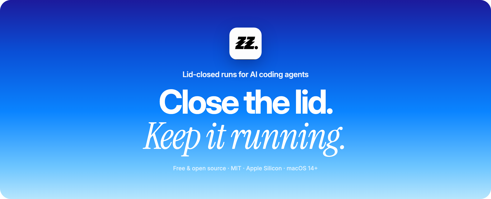

<p align="center">
  
</p>

<p align="center">
  <b>Lidlezz keeps your MacBook awake while your coding agent works, throttles everything the moment the lid closes,<br>
  and puts the Mac to sleep before it gets hot or the battery runs low.</b>
</p>

<p align="center">
  <a href="https://github.com/witcharon/lidlezz/releases/latest/download/Lidlezz.dmg"></a>
  <a href="https://lidlezz.app/#donate"></a>
  <a href="https://lidlezz.app"></a>
</p>

<p align="center">
  
  
  
</p>

---

## Install

```sh
brew install --cask witcharon/tap/lidlezz
```

Or download the notarized DMG from [lidlezz.app](https://lidlezz.app) or the [latest release](https://github.com/witcharon/lidlezz/releases/latest).

Lidlezz is free and open source under the [MIT license](LICENSE). If it saves you a night of babysitting a laptop, you can [support its development](https://lidlezz.app/#donate).

## What it does

- **Awake only while an agent works.** Every three seconds Lidlezz asks one question: may the Mac sleep right now? If a connected agent is working, sleep is held off; if none is, it is released. The decision can't wait for the lid to close (if `pmset disablesleep` is off at that moment the Mac sleeps at once), so the flag is set ahead of time while the agent runs.
- **Throttled the moment the lid closes.** On battery with no external display, closing the lid moves the agent's process tree to background QoS (efficiency cores), turns on Low Power Mode and pauses Time Machine and Photos analysis. Opening the lid or plugging in brings it all back. On the charger nothing is slowed down; heat and battery guards always run.
- **Watched every three seconds.** SoC temperature is read straight from the sensors. Past 95° lid-closed mode turns off; with the lid closed the Mac is put to sleep and the session continues with `claude --resume`.
- **Two settings.** The battery level where sleep is allowed again (default 15%) and how many minutes after the last job it waits (3–30, default 10), so the Mac does not drop off between two prompts.
- **A manual switch** keeps the Mac awake for two hours, for tools that have no hooks.
- **Rejoin when offline.** If the Mac loses all network mid-run, it can rejoin a saved Wi-Fi network you pick (an iPhone hotspot, say). Off by default.
- **Opens at login** (can be turned off in the panel), so agents are never left unprotected after a restart. Every run is appended as one line to `~/Library/Application Support/Lidlezz/runs.jsonl`.

## Supported coding agents

Lidlezz needs two things from each tool: which processes to throttle when the lid closes, and, when possible, when it is actually working. Without the second, the heat, battery and throttling guards still work; you just turn the mode on by hand.

| Agent | Coverage | Written to |
|---|---|---|
| Claude Code | Full. Start, tool calls, finish, usage-limit waits | `~/.claude/settings.json` |
| Cursor | Full. sessionStart, beforeSubmitPrompt, preToolUse, stop, sessionEnd | `~/.cursor/hooks.json` |
| Antigravity | Full. PreToolUse, Stop | `~/.gemini/config/hooks.json` |
| opencode | Full. tool.execute.before, session.idle | `~/.config/opencode/plugin(s)/lidlezz.js` |
| Codex CLI | Partial. Only reports that a turn finished | `notify` in `~/.codex/config.toml` |
| Claude for Mac (Cowork) | None. Use the manual switch | — |

<details>
<summary>Notes on Codex and desktop apps</summary>

- **Codex has a single event**, `agent-turn-complete`. The hook never says a turn started, but the process does: while a turn runs, Codex spawns child processes for the tools it calls, and none while it waits on you. So it counts as working while those children exist, and idle once the hook reports the turn ended. Later turns in an interactive session are covered the same way.
- **Codex allows only one notify command.** If you already have one, Lidlezz does not remove it: it installs `~/.codex/lidlezz-notify.sh`, which tells Lidlezz first and then runs your old command. The old command is kept in the script on a `# lidlezz-previous:` line and restored by `lidlezz hooks uninstall codex`.
- **Desktop apps stay open all day**, so their presence does not mean they are working. For these tools the mode ends on the idle timeout, not when processes disappear.
- Each writer only touches entries carrying its own signature; your own hooks stay where they are.

</details>

## Command line

The CLI ships inside the app:

```sh
lidlezz                 # run the mode in the terminal (Ctrl-C turns it off)
lidlezz status          # temperature, battery, lid, sessions
lidlezz sensors         # every temperature sensor
lidlezz agents          # which agents are installed and connected
lidlezz hooks install   # connect every agent found (uninstall / status)
lidlezz helper install  # install the helper daemon (status)
lidlezz battery 20      # battery level where the mode turns off
lidlezz idle 15         # minutes of idle before an automatic run ends (3-30)
```

To type it short:

```sh
ln -s /Applications/Lidlezz.app/Contents/MacOS/lidlezz ~/.local/bin/lidlezz
```

## How the helper works

On Apple Silicon the only way to stay awake with the lid closed is `pmset disablesleep`, and that needs root. A small helper daemon inside the app does it (`SMAppService`). On first setup macOS asks once for approval in System Settings › General › Login Items › Allow in the Background. The helper only accepts calls from the Lidlezz app signed by the same team as the helper itself, and only runs `pmset` and `tmutil`.

## Requirements

Apple Silicon MacBook Air or MacBook Pro, macOS 14 Sonoma or later. Details in [docs/SUPPORTED-MACS.md](docs/SUPPORTED-MACS.md).

## Build from source

Requires Xcode command line tools (Swift 5.10+).

```sh
git clone https://github.com/witcharon/lidlezz.git && cd lidlezz
./scripts/install.sh   # builds, installs /Applications/Lidlezz.app, wires the hooks, opens it
```

`./scripts/bundle.sh` only builds `dist/Lidlezz.app`. It signs with the first "Developer ID Application" or "Apple Development" certificate in your keychain; pick one with `SIGN_IDENTITY`. The helper needs a real signature (not ad hoc) to accept the app's calls, so build with a certificate of your own.

| Folder | What lives there |
|---|---|
| `Sources/LidlezzCore` | Guard policy, sensors, power, hooks, settings |
| `Sources/LidlezzApp` | Menu bar app (SwiftUI) and Sparkle updates |
| `Sources/LidlezzHelper` | Root daemon that runs `pmset` / `tmutil` |
| `Sources/lidlezz` | Command line tool |

Maintainers: the release flow is in [RELEASING.md](RELEASING.md).

## Contributing

Issues and pull requests are welcome. Keep changes small and focused; Lidlezz deliberately has very few settings.

## License

[MIT](LICENSE)
